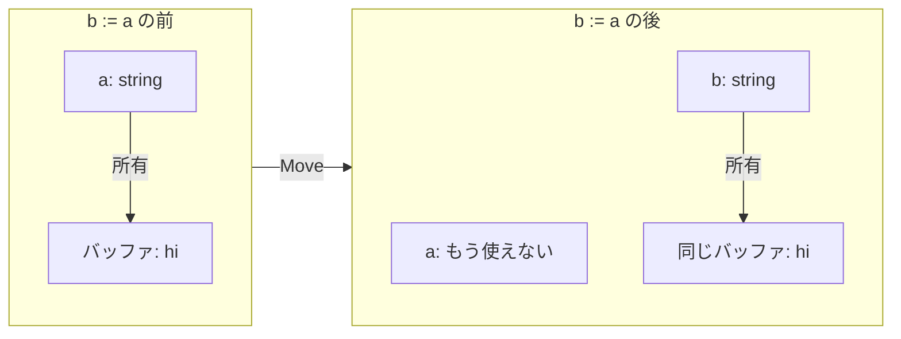
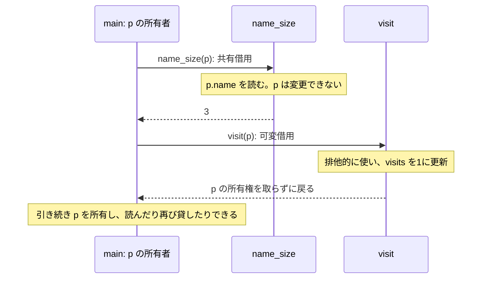
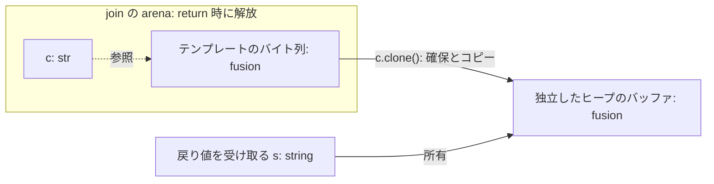

# メモリ: 値、arena、heap

> 🌐 [English](../05-memory.md) · **日本語**

安全な Align コードにはガベージコレクタや手動の `free` はありません。所有権は型の性質であり、ライフタイムはソース上の注釈なしに推論されます。値・arena 内のデータ・独立した所有領域を使い分け、コンパイラが move と借用の寿命を検査して後始末を挿入します。`unsafe` の raw メモリには別途守るべき条件があります（[15 章](15-unsafe-and-ffi.md)）。

## 値(既定)

数値、bool、Copy な構造体、スカラーのタプルは Copy 値です。代入や引数渡しでは内容をコピーします。これらの例ではヒープ確保やリソースの解放は不要です。

```align
Point { x: f64, y: f64 }

fn main() -> i32 {
    p := Point { x: 1.0, y: 2.0 }
    q := p              // a copy; p and q are independent
    return 0
}                       // scope ends, values are simply gone
```

大きな構造体の値渡しでは、全フィールドがコピーされます。サイズがキャッシュライン2本分を超えると、コンパイラは警告（`huge struct copy`）を出します。読むだけのヘルパーには共有 `borrow` パラメータを使います。コレクションをフィールドごとに処理する場合は、スライスや SoA（[11](11-data-oriented.md) 章）も検討してください。

## Move 型 —— 所有権を型に持たせる

ヒープ上のリソースを所有する型（`string`、`array<T>`、`buffer`、`box`、I/O ハンドルなど）は **Move** 型です。代入すると所有権が移り、元の変数を使おうとするとコンパイルエラーになります。

```align
fn main() -> i32 {
    a := "hi".clone()   // a `string` — an owned heap buffer
    b := a              // ownership moves to b
    print(a.len())      // error: use of moved value 'a'
    return 0
}
```

ムーブ後の所有者は1つだけなので、コンパイラはリソースを解放する時点を決められます。所有者がスコープを抜けるとバッファが破棄され、`mut` な所有者に新しい値を代入すると、先に古い値が破棄されます。`string` など複製に対応する型では、`.clone()` で独立したコピーを作れます。ただし、すべての Move 型のリソースを複製できるわけではありません。

所有フィールド（例えば `name: string`）を持つ構造体も Move 型です。Drop では所有フィールドを再帰的に解放します。`u.name.len()` のような読み取りは、所有権を移さず `str` ビューとして借用します。

左右は、同じバッファを `b := a` の前後で見た図です。文字列のバイト列はそのままで、所有者が変わります。



以降、バッファをいつ解放するかは `b` の寿命で決まります。`b := a.clone()` なら、独立したバッファが2つでき、どちらの変数も引き続き使えます。

## 関数に渡す、借りる、更新する

Move 型の `Profile` を通常の引数として渡すと、所有権が関数へ移ります。呼び出し元のレコードを読むだけなら `borrow`、そのレコードを更新するなら `borrow mut` を使います。

```align
Profile { name: string, visits: i64 }

fn name_size(borrow p: Profile) -> i64 = p.name.len()

fn visit(borrow mut p: Profile) {
    p.visits = p.visits + 1
}

fn main() -> i32 {
    mut p := Profile { name: "Ada".clone(), visits: 0 }
    print(name_size(p))    // 3
    visit(p)
    print(p.visits)        // 1
    print(p.name.len())    // 3 — p is still owned here
    return 0
}
```

渡し方は関数の宣言に書き、呼び出しは `visit(p)` のままです。共有借用の関数は `p` をムーブ、置換、破棄できません。可変借用には書き換え可能な値が必要で、呼び出し中は関数が排他的に使います。呼び出しが置き換えたり無効化したりする領域への古いビューは、その後に使えません。更新後に新しいビューを取得します。コンパイラは重ならないレコードフィールドを区別しますが、参照先の領域が共有され得るビューは競合します。

必要なのが文字列や配列の要素だけなら、レコード全体を借りずに `str` や `slice<T>` を渡せます。大きな Copy 型の構造体をコピーせずに読みたい場合も、共有の `borrow` が使えます。Copy 型のフィールドの更新を呼び出し元へ反映したい場合は、`borrow mut` が必要です。

この例の2回の呼び出しを追ってみます。どちらも `p` の所有権を渡しません。



この2つの関数の戻り値は整数と Unit です。ビューを返す関数なら、呼び出し後にも `p` への参照が残ることがあります。そのビューも、`p` の寿命と変更に関する規則に従います。

### 所有フィールド全体の取り出し

変数に束縛されたレコードから、直接の所有フィールド全体を取り出せます。配列、入れ子のレコード、タプルも同じ規則で移動でき、他のフィールドは引き続き使えます。

```align
Items { values: array<i64>, marker: i64 }
fn main() -> i32 {
    owner := Items { values: [10, 20].to_array(), marker: 7 }
    values := owner.values
    print(values.sum())  // 30
    print(owner.marker)  // 7
    return 0
}
```

clone やメモリ確保を行わずに所有権を移します。元のフィールドや部分的に移動したレコード全体は再利用できず、元のフィールドへの代入で復元することもできません。借用したレコードからは取り出せません。さらに深いフィールドを移動する場合は、まず直接の内側レコード全体を別の変数へ取り出します。動的な領域の既存ビューは新しい所有者に追従し、内部の借用値は元の参照先に依存し続けます。移動したインライン領域のビューは無効になります。

### 所有フィールドの置換と配列の短縮

可変レコードや `borrow mut` を通して、所有フィールドを置き換えられます。

```align
fn rename(borrow mut p: Profile, name: str) {
    p.name = name.clone()
}
```

先に右辺を評価してから所有権をフィールドへ移し、古い値が生きていれば1回だけ破棄します。兄弟フィールドはそのままです。対応する所有配列や入れ子の Move レコードも置き換えられます。暗黙の clone はなく、この例では入力が借用テキストなので明示してコピーしています。置換後もレコードのメモリ確保方式を揃える必要があります。

所有する動的配列の先頭部分だけを残すなら、その場で `truncate` します。

```align
fn main() -> i32 {
    mut ids := [10, 20, 30, 40].to_array()
    ids.truncate(2)
    print(ids.sum())    // 30
    return 0
}
```

`truncate` には可変の所有者と `0 <= new_len <= old_len` が必要です。不正な長さは変更前にアボートします。取り除く要素が所有する値は破棄しますが、配列自体の領域は保持し、コピーもメモリ確保もしません。配列を伸ばしたり、余った容量をアロケーターへ返したりする操作ではありません。固定長配列やスライスには使えません。古い配列へのビューを使い終えてから短縮し、必要なビューを取り直します。

## arena —— ライフタイムでまとめて確保する

ある一連の処理の中で、同じタイミングで不要になる複数の一時データを確保したい場合（例えば、ファイルのパース、リクエストの組み立て、バッチ処理でのデコードなど）は、その処理ブロックを `arena {}` で囲みます。

```align
fn join(a: str, b: str) -> string {
    arena {
        c := template "{a}{b}" // arena-backed temporary
        return c.clone()    // copy the result out — visible escape
    }                       // all arena storage released here
}

fn main() -> i32 {
    s := join("fu", "sion")
    print(s)                // fusion
    return 0
}
```

ここで `c` は、arena に確保したテンプレートの領域を指すビューです。`c.clone()` は独立した文字列の領域を確保し、`join` から戻る前にバイト列をコピーします。



関数から戻ると arena の領域は解放されますが、コピー先のバッファは `s` が所有しています。そちらは `s` が破棄されるときに解放されます。`c` 自体を返すと、呼び出し元に解放済みの領域への参照が残るため、コンパイラが拒否します。`c.len()` のような独立した数値なら、文字列をコピーせずに外へ返せます。

arena は通常、確保済みブロック内のポインタを進めて領域を割り当て、必要に応じて新しいブロックを確保します。arena を抜けると、それらのブロックをまとめて解放します。一時データを1つずつ解放する手間は省けますが、値を作る処理や、ブロック自体の確保と解放には処理量がかかります。

コンパイラはすべての値の **region（有効範囲）** を追跡します。そのため、arena 内で確保された値が、その arena のスコープ外に持ち出されることはありません。

```align
fn leak(a: str, b: str) -> str {
    arena {
        s := template "{a}{b}"
        return s        // error: cannot return a value allocated in an arena
    }                   //        (it is freed at block end)
}
```

region の注釈を書く必要はありません。参照がデータより長く残る場合、コンパイラがエラーを報告します。文字列の例では、`str.clone()` で独立した所有文字列を作れます。ただし、arena 内のすべての値に複製操作があるわけではありません。コレクションを返す場合は、所有権を持つ結果の型と、その領域をどこで確保するかを選びます。

たとえば、関数内の arena で `.to_array()` を呼ぶと、`array<T>` は Move 型でも、その領域は arena に属します。Move は所有権の移動を、有効範囲の推論は領域をいつまで使えるかを決めます。ローカルな arena を持たない補助関数なら、借りた入力から独立した結果を確保できます。呼び出し元の arena は暗黙には引き継がれません。[Little Aligner 15章の Q19](../../little-aligner/ja/15-read-it-four-ways.md)に、スコアの配列を返す例があります。`i64` の要素は独立した値ですが、`str` の配列では、配列自体を所有していても各ビューが借りる領域への依存は残ります。

## heap を、明示的に

`heap.new(x)` は、単一の値を明示的にヒープに確保し（`box`）、それを取り囲む（現在の）arena のライフタイムに紐付けます。確保した値は `.get()` で読み出します。

```align
fn main() -> i32 {
    arena {
        b := heap.new(42)
        print(b.get())      // 42
    }
    return 0
}
```

この例のように、確保した box をすぐ読み戻すパターンには警告が出ます。

```text
warning: unnecessary heap allocation: this box is only ever read back with
         `.get()` and never escapes — use the value directly (a stack value
         suffices)
```

上の警告は、この box が `.get()` で読み戻されるだけなので、値を直接使えばよいことを示しています。`heap.new` は、値を作ったスタックフレームよりも長く保持し、かつ特定の arena 内に置きたいときに使います。それ以外では、値や arena 内のコレクションを使います。

## ビュー: `str` と `slice<T>`

`str` はテキスト、`slice<T>` は配列要素を参照するビューです。どちらもポインタと長さを持つ Copy な記述子です。コンパイラは参照先の寿命を追跡します。arena のデータへのビューはその arena を越えて保持できず、レコード内の inline な領域へのビューはレコードより長く使えません。

```align
fn main() -> i32 {
    xs := [10, 20, 30, 40]
    s := xs[1..3]           // slice view: elements 1 and 2, no copy
    print(s.sum())          // 50
    return 0
}
```

## 判断の手順

データを保持する期間に応じて、配置を選びます。

- この式、あるいはこのスコープ内で不要になる → **値（Value）**。特別なことは何もしません。
- 一連の処理の終わりにまとめて不要になる → **arena**。独立したスカラー値はそのままコピーして外へ出せます。残すテキストには `.clone()`、コレクションには独立した所有結果を構築する経路を使います。
- 現在の関数フレームよりも長生きさせるべき単一の値 → 適切なライフタイムを持つ arena 内で **`heap.new`** を使います。
- 既存のデータを読むだけ → **ビュー**（`str`、`slice`）。メモリ確保や参照先のデータのコピーは行いません。

コンパイラは所有権の移動と借用の寿命を検査し、後始末を挿入します。ソースでは `arena {}` や `arena r {}` で寿命の範囲、`.clone()` でテキストのコピー、`borrow` や `borrow mut` で呼び出し元のデータへのアクセスを示します。
